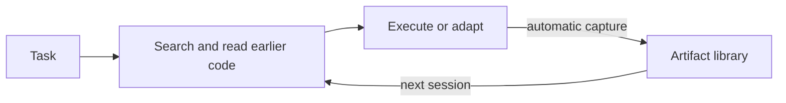

# Durable code library

Capture generated JavaScript in an Artifact. In later sessions, search the
library, read an earlier solution, and execute or adapt it through Code Mode.
Computer saves that execution too.



## Give Workspace a library

```ts
const workspace = new Workspace({
  storage: ctx.storage,
  sessionId,
  backends: [new CodemodeBackend({ loader: env.LOADER })],
  codeLibrary: { binding: env.ARTIFACTS, repository: "finance-code" },
});

await workspace.ready();
await workspace.codeLibrary?.refresh(); // start of each turn
const tools = createAITools({ workspace });
```

The binding selects an Artifacts namespace. The repository name selects which
sessions share code. In an application, derive it from the authorized user or
project.

| Selection | Result |
| --- | --- |
| Same binding and repository | Sessions share the library. |
| Different repository names | Libraries stay separate. |
| Session ends | The Artifact remains. |
| `readOnly: true` | Read an existing library using read tokens; executions do not append to it. |

## Run the learning loop

```sh
# From the repository root:
npm install
npm run build --workspace @cloudflare/computer
cd examples/durable-code
cp .dev.vars.example .dev.vars
# Set DEMO_TOKEN to a random secret in .dev.vars, then:
cf dev
```

Artifacts and Workers AI use remote bindings. If `cf dev` cannot find the
hoisted Wrangler installation, run:

```sh
mkdir -p node_modules
ln -s ../../../node_modules/wrangler node_modules/wrangler
```

Set `DEMO_TOKEN` in your terminal. Alice creates and executes code:

```sh
curl 'http://localhost:8787/run?repository=finance-code' \
  -H "Authorization: Bearer $DEMO_TOKEN" \
  -H 'Content-Type: application/json' \
  -d '{"sessionId":"alice","task":"Write and execute a self-contained module that sums input.amounts. Try [12, 8, 5]."}'
```

Bob starts a fresh conversation and reuses it:

```sh
curl 'http://localhost:8787/run?repository=finance-code' \
  -H "Authorization: Bearer $DEMO_TOKEN" \
  -H 'Content-Type: application/json' \
  -d '{"sessionId":"bob","task":"Search your code library for the sum function. Read it and execute it with [3, 4, 9]."}'
```

Inspect both captured executions:

```sh
curl 'http://localhost:8787/library?repository=finance-code' \
  -H "Authorization: Bearer $DEMO_TOKEN"
```

Every request requires the demo token. Change `repository=engineering-code` to
use a separate library. The default is `finance-code`.

## What the agent sees

```text
/workspace/.code-library/
  runs/<id>/code.js
  runs/<id>/metadata.json
```

Ordinary `ls`, `grep`, and `read` tools work on this read-only directory. Each
record includes purpose, execution and session identities, timestamps, and the
observed outcome. Code runs through the ordinary sandboxed `exec` tool.

```ts
using run = await workspace.runtime.exec(
  "export default ({ amounts }) => amounts.reduce((sum, n) => sum + n, 0)",
  {
    backend: "codemode",
    input: { amounts: [12, 8, 5] },
    metadata: { purpose: "Sum invoice amounts", sessionId: "alice" },
  },
);
await run.result(); // result: 25
```

Capture stores module source. Imported files, dependencies, inputs, outputs,
and shell-launched JavaScript are outside this snapshot. Use self-contained
modules for reuse.

## Sharing and failures

The example routes each repository to one durable host writer and serializes
its turns. Other Workspaces can use `readOnly: true` and call `refresh()` at the
start of each turn.

| Rule or event | Behavior |
| --- | --- |
| Refresh | Load a committed snapshot and update the mount. No background polling. |
| Between refreshes | Reads keep that snapshot; local captures update the writer's view. |
| Writer coordination | One writer per repository. Conflicting pushes reject and retain local commits. |
| Local storage | One repository identity per storage database. |
| Source push fails | Execution does not start. |
| Dispatch acknowledgement is lost | Status stays `started` until a terminal event is observed. |
| Outcome push fails | Return the execution result and retain the outcome locally for retry. |

The application owns the Artifact's lifetime and retention through the
Artifacts API. For many independent writers, use separate capture repositories;
see [Artifacts best practices](https://developers.cloudflare.com/artifacts/concepts/best-practices/).
