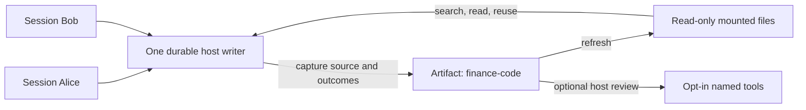

# Shared durable code library

Save generated JavaScript to an Artifact. Let later sessions find and reuse it.
Optionally review a successful run and expose it as a named tool.



## Select the library

```ts
const workspace = new Workspace({
  storage: ctx.storage,
  sessionId,
  backends: [new CodemodeBackend({ loader: env.LOADER })],
  codeLibrary: { binding: env.ARTIFACTS, repository: "finance-code" },
});

await workspace.ready();
await workspace.codeLibrary?.refresh(); // start of each turn
const tools = createAITools({ workspace });
```

| Choice | Result |
| --- | --- |
| Same binding + `"finance-code"` | Sessions share one library. |
| Different repository names | Libraries stay separate. |
| Session ends | The Artifact remains. |
| `capture: false` | Read and curate without automatically saving executions. |
| `readOnly: true` | Read an existing library using read tokens; no capture or curation. |

The binding selects a namespace. The repository name selects the sharing and
retention boundary. In an application, derive that name from the authorized
user or project.

## Run across sessions

```sh
# From the repository root:
npm install
npm run build --workspace @cloudflare/computer
cd examples/durable-code
cp .dev.vars.example .dev.vars
# Set DEMO_TOKEN to a random secret in .dev.vars, then:
cf dev
```

Artifacts and Workers AI use remote bindings. If `cf dev` cannot find the
hoisted Wrangler installation, run:

```sh
mkdir -p node_modules
ln -s ../../../node_modules/wrangler node_modules/wrangler
```

Set `DEMO_TOKEN` in your terminal. Alice creates code:

```sh
curl 'http://localhost:8787/run?repository=finance-code' \
  -H "Authorization: Bearer $DEMO_TOKEN" \
  -H 'Content-Type: application/json' \
  -d '{"sessionId":"alice","task":"Write and execute a function that sums input.amounts. Try [12, 8, 5]."}'
```

Bob reuses it in a fresh conversation, before any promotion:

```sh
curl 'http://localhost:8787/run?repository=finance-code' \
  -H "Authorization: Bearer $DEMO_TOKEN" \
  -H 'Content-Type: application/json' \
  -d '{"sessionId":"bob","task":"Find the sum function in your library and use it with [3, 4, 9]."}'
```

Change `repository=engineering-code` to use another library and writer.
The default is `finance-code`. Every endpoint requires the demo token.

## Read a consistent snapshot

The example routes each repository to one durable agent and serializes its
turns and host operations. Other Workspaces can read the same library:

```ts
const reader = new Workspace({
  storage: readerStorage,
  sessionId: "another-session",
  codeLibrary: {
    binding: env.ARTIFACTS,
    repository: "finance-code",
    readOnly: true,
  },
});

await reader.ready();                       // initial snapshot
await reader.codeLibrary?.refresh();         // next turn's snapshot
await reader.fs.grep("sum", "/workspace/.code-library");
```

| Rule | Behavior |
| --- | --- |
| Refresh timing | The host calls `refresh()` at turn boundaries. No background polling. |
| Between refreshes | Reads use the current snapshot. Local library writes update that Workspace's view. |
| Writer coordination | One writer per repository; sequential handoffs synchronize before writes. |
| Conflicting push | Reject and retain the local commit. No force-push or automatic merge. |
| Local storage | Keep one repository identity per storage database. |

For many autonomous writers, use separate capture repositories and a shared
curated library. [Artifacts best practices](https://developers.cloudflare.com/artifacts/concepts/best-practices/)
explain that scaling boundary.

## Optional review and promotion

Inspect the source and metadata:

```sh
curl 'http://localhost:8787/library?repository=finance-code' \
  -H "Authorization: Bearer $DEMO_TOKEN"
```

Choose a successful run, review it, and promote it:

```sh
curl 'http://localhost:8787/promote?repository=finance-code' \
  -H "Authorization: Bearer $DEMO_TOKEN" \
  -H 'Content-Type: application/json' \
  -d '{"id":"<run id>","name":"sum_amounts","description":"Sum input.amounts, an array of numbers; return the total."}'
```

Set `useReviewedTools: true` in a later `/run` body to expose
`saved_sum_amounts`. The equivalent host API is:

```ts
await workspace.codeLibrary?.promote(runId, "sum_amounts", description);
const tools = createAITools({ workspace, savedCodeTools: true });
```

The tool accepts a JSON-encoded `input` object. Its description explains the
fields. Promotion pins the source and records `approvedAt`. Rebuild the tool
set after refresh to pick up review decisions. Without the opt-in, file-based
reuse still works.

## Retention and host API

These operations belong to the host; none becomes a model tool.

| API | Purpose | Demo endpoint |
| --- | --- | --- |
| `list()` / `read(id)` | Inspect captured source and outcomes. | `GET /library` |
| `refresh()` | Load a new committed snapshot and update the mount. | Before every turn |
| `promote(id, name, description)` | Approve and pin successful source. | `POST /promote` |
| `promoted()` | List reviewed code. | Included in `/library` |
| `unpromote(name)` | Remove a reviewed tool. | `DELETE /tools/<name>` |
| `deleteRun(id)` | Remove an unpromoted run from the current tree. | `DELETE /runs/<id>` |

All endpoints accept `?repository=finance-code`. For example:

```ts
await workspace.codeLibrary?.unpromote("sum_amounts");
await workspace.codeLibrary?.deleteRun(runId);
```

Git history retains deleted files. Rotate or delete the Artifact for the full
retention boundary; use fresh local storage for another repository identity.

## What gets saved

Pass a self-contained module to `exec`. For example, the host API captures this
source and purpose:

```ts
using run = await workspace.runtime.exec(
  "export default ({ amounts }) => amounts.reduce((sum, n) => sum + n, 0)",
  {
    backend: "codemode",
    input: { amounts: [12, 8, 5] },
    metadata: { purpose: "Sum invoice amounts", sessionId: "alice" },
  },
);
await run.result(); // result: 25
```

```text
/workspace/.code-library/
  runs/<id>/code.js
  runs/<id>/metadata.json  # purpose, ids, timestamps, status, exit code
  tools/<name>.json       # optional reviewed source and approval time
```

| Event | Result |
| --- | --- |
| Capture push fails | Execution does not start. |
| Dispatch acknowledgement is lost | Status stays `started` until a terminal event is observed. |
| Outcome push fails | Return the actual result; retain the local outcome for retry. |
| Execution handle is replayed | Record the observed outcome. |

Capture saves module source. Inputs, environment variables, output, imported
files, dependencies, and shell-launched JavaScript are outside this snapshot.
Git data and credentials stay outside the read-only mount. A successful exit
does not imply human approval.

## Existing snippets, skills, and per-agent mode

| Need | Use |
| --- | --- |
| Connector-backed Code Mode scripts | Existing [`saveSnippet` / `codemode.search` / `codemode.run`](https://github.com/cloudflare/agents/blob/main/docs/codemode/snippets.md). |
| Computer module source across sessions | This Artifact-backed library. |
| Curated instructions and supporting scripts | [Workspace skills](https://developers.cloudflare.com/agents/skills/sources/computer/). |
| Per-agent convenience | `codeLibrary: true` with scoped `artifacts` and a non-empty `sessionId`; selects `<sessionId>__code-library`. |

Code Mode snippets store connector function source on their durable runtime;
Computer runs modules with a default export. The snippet runtime has no storage
provider hook, so this example does not change its store or execution contract.
